# Flagship — Product Walkthrough

Flagship is a feature-flag control plane for teams that need to change application behavior safely without rebuilding or redeploying for every release.

This walkthrough follows the product as a real user would use it:

**Create a workspace → define the release environment → create a flag → define an audience → configure targeting → simulate decisions → integrate the SDK → review the change history → manage access**

The screens below are captured from real browser flows after the corresponding product action completed successfully.

## 1. Start with a workspace

The experience begins with a focused workspace setup flow. A user provides their name, organization, email, and password, then enters the authenticated control plane.

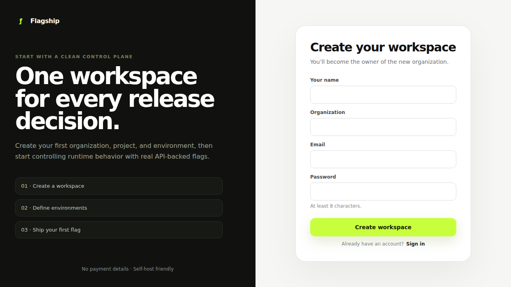

## 2. See the workspace before adding release controls

After signup, the user lands in the console. A new workspace starts clean, with the next product action being to create the first project.

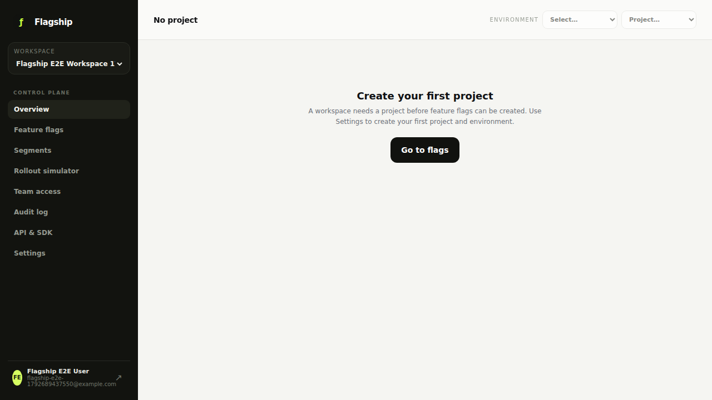

## 3. Create a project and release environment

Projects organize the release controls. Each project can have its own environments, and an environment receives its own SDK credential.

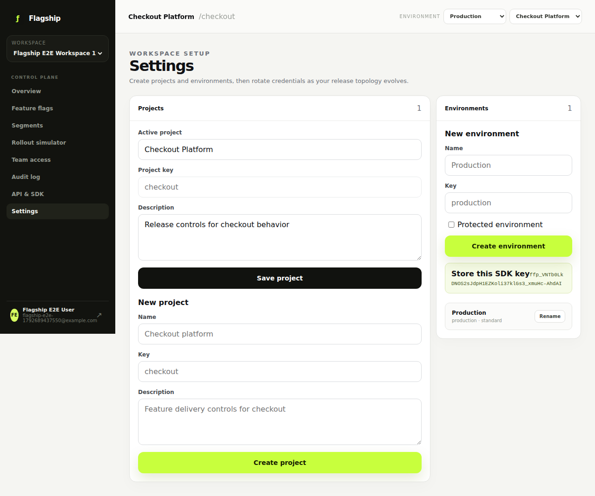

The workflow is persistent: the project and environment are created through the console, saved in the backend, and immediately become the active workspace context.

## 4. Define a reusable audience

Segments let a team define an audience once and reuse it across multiple targeting rules.

In this flow, the `beta-users` segment is created and given a `plan = pro` condition.

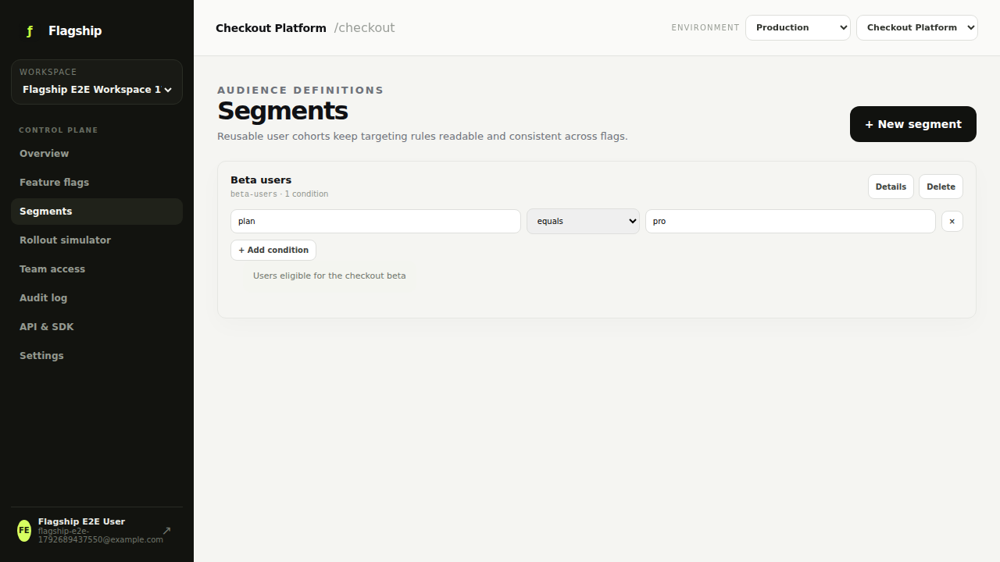

After saving, the segment is reloaded from the backend so the screen is showing persisted targeting data rather than local-only state.

## 5. Create and control a feature flag

A feature flag is created as a typed control with a safe default. The environment state can then be enabled independently from the flag definition.

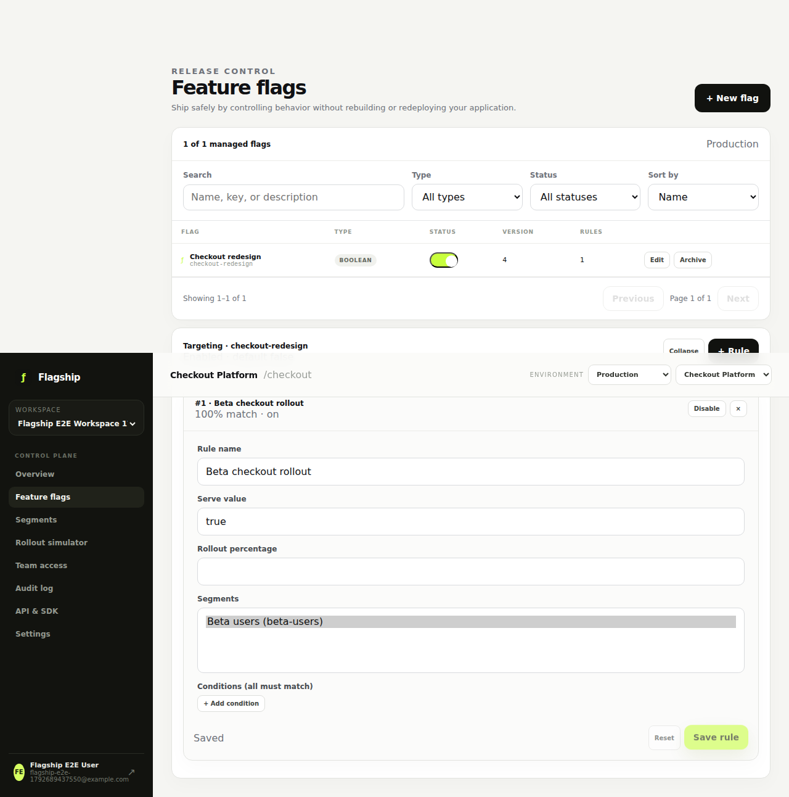

The targeting rule in this walkthrough serves `true` only for the reusable beta audience. Everyone else keeps the flag's default value.

## 6. Preview real decisions before rollout

The rollout simulator lets a product or engineering user submit representative users and see the decision produced by the same server-side evaluation rules used by the platform.

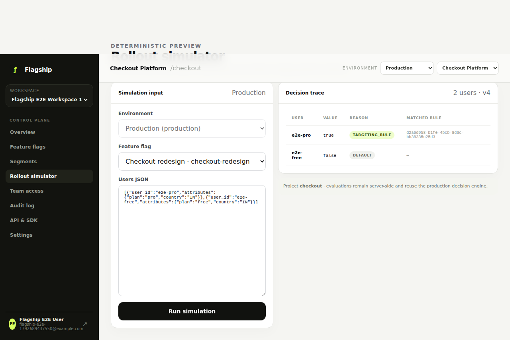

For the walkthrough data, a `pro` user matches the targeting rule while a `free` user falls back to the default value.

## 7. Connect an application with an environment SDK key

The API & SDK area exposes environment-scoped credentials and the public evaluation contract. Keys are rotated from the console, while the one-time secret is revealed only at creation or rotation.

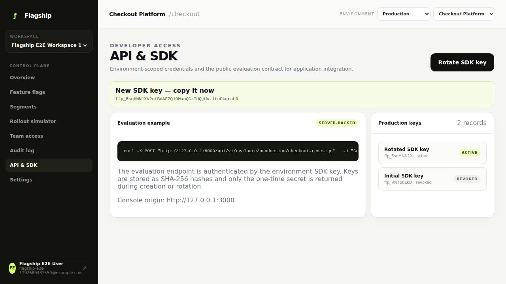

The product flow continues beyond the UI: the resulting key can be used by an application to evaluate the same flag for a real user context.

## 8. Keep a durable change history

Every important control-plane mutation appears in the audit history so a team can understand what changed and when.

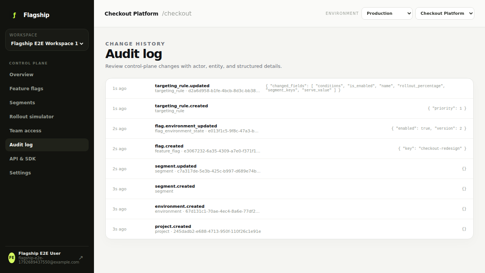

This makes a release decision explainable without relying on memory or scattered external notes.

## 9. Manage workspace access

Team access shows the current organization membership and role. Owners and admins have the controls appropriate to their role, while read-only members do not receive mutation controls.

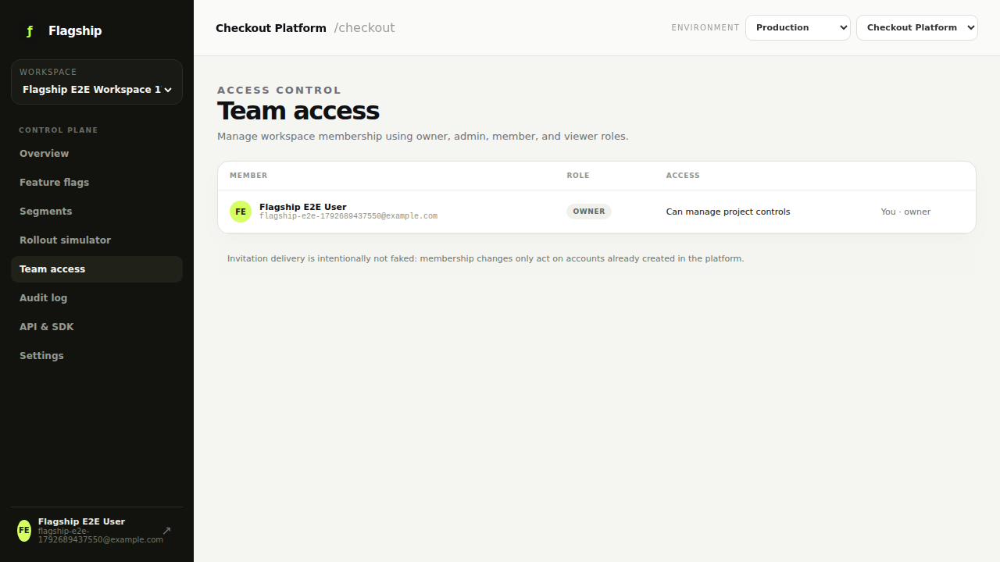

## 10. Return to the operational overview

The overview brings the release picture back together: active flags, enabled state, environments, targeting rules, and recent changes.

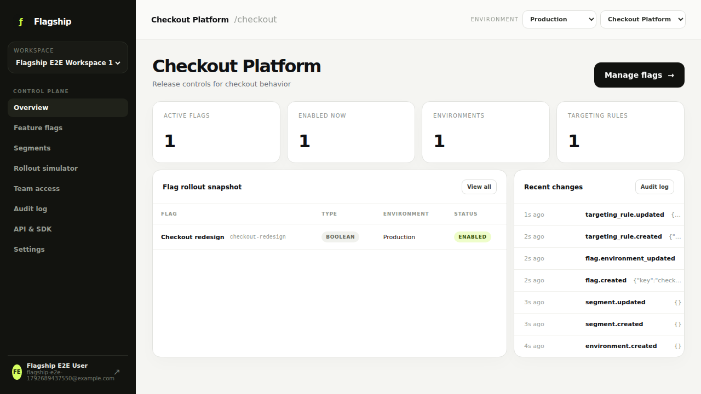

## 11. The core product flow

The complete user journey demonstrated here is:

**User action → control-plane screen → persisted API operation → targeting/evaluation decision → API response → updated screen**

For example, the flag flow is:

**Create flag → save to workspace → enable in an environment → attach reusable audience → simulate users → evaluate through the SDK contract → record the change in audit history**

That makes the walkthrough more than a collection of UI screens: each important screen represents a real state transition in the product.

## 12. The console routes

The remaining console areas are exercised as connected product surfaces rather than isolated pages.

### Feature flags

### Segments

### Rollout simulator

### Team access

### Audit history

### API & SDK

### Settings

### Overview

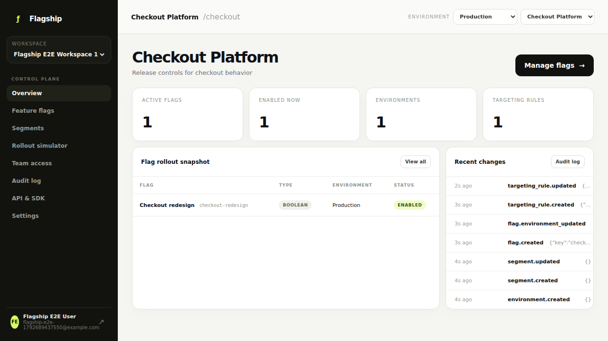

## 13. Mobile experience

The control plane also adapts to a smaller viewport. The navigation collapses behind a menu while keeping the same product areas available.

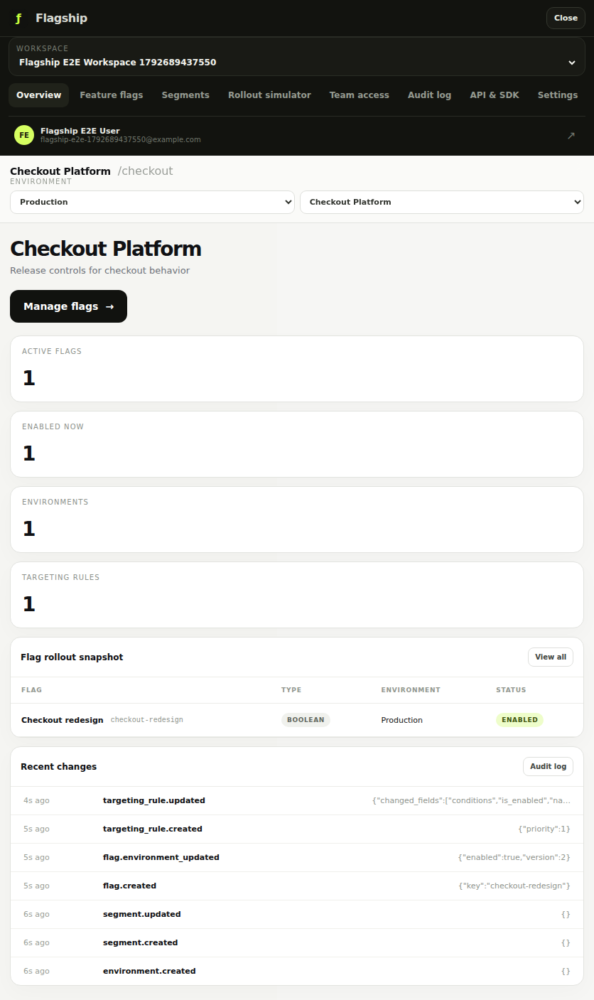

## Product takeaway

Flagship is designed around a simple operational idea: teams should be able to change application behavior deliberately, see exactly who will receive that behavior, test the outcome before rollout, connect applications through a scoped evaluation contract, and retain a clear history of the decisions that were made.
